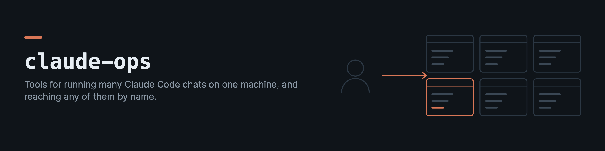

# claude-ops

claude-ops is a set of small tools for people who run many Claude Code chats on one Mac at the same time, in different project folders. It finds any chat from any folder, sends a message into a chat that is already running, starts chats inside tmux so they can be reached by name, wakes a chat from a scheduled job when something new happens, and adds a few hooks and skills that came out of daily use.

Everything here started as scripts I wrote for my own machine. I made them general and tested before publishing them.

## Install

```bash
pip install claude-ops
```

It needs Python 3.9 or newer and nothing else from PyPI. Sending into iTerm2 uses AppleScript, so that part works only on macOS. The tmux parts work wherever tmux does.

## Find any chat

Claude Code stores every chat under `~/.claude/projects`, and `claude --resume` only sees the chats of the folder you are in.

```bash
claude-ops sessions                 # all chats from every folder, newest first
claude-ops sessions login           # filter by title, first message, folder or branch
claude-ops search "pg_restore"      # search the full text of every chat (uses ripgrep if it can find it)
```

Each result prints the line that resumes it (`cd <folder> && claude --resume <id>`). The index is cached in `~/.cache/claude-ops/sessions.json` and only changed files are read again, so a later run over twenty thousand chats takes a second or two. The time shown is the last message in the chat, not the file's modification time, because backup and restore tools give every file a new time. A chat is marked "maybe running" when it was active in the last 15 minutes and a `claude` process is running in its folder. Those are two separate facts, so it says "maybe".

## Read what was asked, with what came around it

A transcript holds much more than the person's messages, and a message typed while Claude was still working is often not a "user" record at all (it is queued, and may arrive as an attachment or never as a user record). `claude-ops messages` reads every shape, keeps only what the person typed or pasted, and shows the conversation around any of it.

```bash
claude-ops messages --since 7d                         # everything typed in the last week, oldest first
claude-ops messages --since 2026-01-05 --until 2026-01-07 --chat "docs-*" --folder ~/code/app
claude-ops messages --since 3d --grep backup --json    # one entry per message, with its id
claude-ops messages --around <session>:<line> --before 6 --after 10 --tools
```

Text written by Claude Code, hooks, skills, task notifications, schedules and other sessions is left out, and so is text a program typed into the terminal (a message that opens with a bracketed tag such as `[watcher]`). Slash commands come with `--commands`. Each message has an id, `<session>:<line>`, and `--around` takes it. In Python, `messages.person_messages(transcripts, since=..., until=..., grep=...)` and `messages.around(path, line, before=..., after=...)` do the same. `messages.last_said(path, before=...)` is the last thing the assistant wrote, read from the end of the transcript, which is what a short reply such as "work on it" answers.

## Find the tracebacks a service logged

A service that logs to a file collects Python tracebacks nobody reads. `claude-ops tracebacks` groups them by exception type and the deepest frame (in your own code when `--prefer` names it), and reads only what came after a byte offset, so a scheduled pass sees each one once.

```bash
claude-ops tracebacks ~/Library/Logs/app.err.log                     # every traceback, grouped and counted
claude-ops tracebacks app.log --prefer "*/myapp/*" --ignore BrokenPipeError --json
claude-ops tracebacks app.log --offset 81920                         # only what came after that byte
```

In Python, `tracebacks.read_new(path, offset)` returns the tracebacks after `offset`, the offset to start from next time and how many bytes it skipped (a backlog over 8 MB is skipped from its start). A traceback still being written at the end of the file waits for the next pass, a log that shrank is read from the start, a chain ("During handling of the above exception") is one traceback named by its last exception, and two threads writing at once keep what was complete. `tracebacks.group(traces, prefer)` folds them by signature, such as `KeyError at handlers.py:render`.

## What a deploy brought

`claude-ops changelog <old> <new>` lists the pull requests merged between two commits, oldest first, so a deploy can say what arrived instead of two hashes. It reads the first-parent history, so the commits inside each pull request are left out.

```bash
claude-ops changelog 4f1c2e0 origin/main                  # "#12 Retry on a timeout", one per line
claude-ops changelog v1.2.0 HEAD --repo ~/src/app --json
```

A merge commit is named by its pull request's title (the first line of the merge commit's body), a squash merge by its subject without the `(#12)`, and a commit pushed straight to the branch by its subject, with no number. In Python, `changelog.merged(old, new, repo)` returns the changes and raises ValueError when git cannot read the range.

## Send a message into a running chat

```bash
claude-ops inject --list                                  # reachable iTerm2 sessions, and which run Claude Code
claude-ops inject --target my-chat --text "please run the tests again"
claude-ops inject --target 0A1B2C3D-1111-2222-3333-444455556666 --file prompt.txt
claude-ops inject --transport tmux --target claude-build --text "..."
```

A target is an iTerm2 session id, part of a tab name, or a tmux session name. Claude Code rewrites tab names, so a job that runs for a long time should keep the session id. Text with several lines is sent as one bracketed paste, so it arrives as one message instead of one message per line.

Before it sends, claude-ops checks that the target is running Claude Code. Text sent into a plain shell would run as a command, so when the check is not sure it refuses (exit code 4). Exit code 3 means the chat is not open.

Every send is written to `~/.local/state/claude-ops/inject.jsonl` before it happens, and its result after, with the same id on both lines. An attempt with no result line means the sender stopped in between. The log keeps the length and a SHA-256 hash of the text, not the text, unless you pass `--keep-text`.

## Merge a pull request only when it is green

```bash
claude-ops merge 123                                   # the repository of the current folder
claude-ops merge 123 --repo owner/name --method squash # waits up to 30 minutes for running checks
claude-ops merge 123 --repo owner/name --method auto --dependency-bump minor   # a bot's update only
```

It waits for every check on the pull request's current head, refuses if any did not pass or if
there are none, and merges that exact head (`--match-head-commit`), so a push in between is refused.
Exit codes: 0 merged, 2 still running or no checks, 3 a check failed, 4 the merge was refused,
5 not open, 6 not the dependency update asked for.

`--method auto` uses the first of merge, squash and rebase the repository allows, so one command
serves repositories with different settings. `--dependency-bump patch` or `minor` merges only a
dependency update a program may take on its own: opened by Dependabot or Renovate (another updater
by `--bot LOGIN`, never any bot: a GitHub App with pull-request write is a bot too), changing only
lockfiles and dependency manifests, every bump named in its title or body ("bump X from A to B")
within that level, with a 0.x version's second number counted as major, and the diff read: every
package a manifest or lockfile moves is one the text names and moves within the level, so a lockfile
that also moves an unnamed transitive dependency across a major, or adds a package, is refused. The
formats read are npm's, yarn.lock, Python's (pyproject.toml, requirements, uv.lock, poetry.lock,
pdm.lock), Cargo's, go.mod and composer's; for another lockfile the text is the only check. Anything
else, a source or workflow file in the change, a bump that cannot be read, a larger move, exits 6
with the reason, before any waiting. In Python, `dependency_bump.review(title, body, files, author, up_to=)` is the
same reading, and `merge.pull_request(number, repo)` reads a pull request with the fields it needs.

## Find general code in a private project

A private project built over public packages tends to grow general code of its own, because that is
where the work happened. `layering` lists the modules that reach none of the project's private
markers (its database driver, the module that writes its records) through their imports, so each one
is a candidate to move into a package:

```bash
claude-ops layering /path/to/project --package app --marker psycopg --marker app.core.record --skip app.tests
```

A good use is a test in the private project that keeps a reviewed list of the modules that stay, each
with its reason, and fails on every new candidate.

## Tools for a repository many chats change

```bash
claude-ops union <worktree> --ordered order.txt --journal CHANGES.md   # in a stopped diff3 rebase
claude-ops secret-shapes <worktree> origin/main --shapes shapes.json   # or --pre-push in a git hook
claude-ops mutate <worktree> --run "pytest -q {copy}/tests" --function src/pkg/mod.py:name
claude-ops plan-apply PLAN.md 'Step 1' 'Step 2'                       # --steps lists them
```

- `union` settles a rebase conflict where both sides only added lines, by keeping both, the
  upstream side first. JSON files merge by key, an `--ordered` file lists each entry once, and a
  `--journal` keeps only what the commit appended. A `--set` file is a ledger whose entry lines are
  an unordered set: every line either side added is kept and every line either side removed is
  dropped, so an entry added beside one the other branch removed still merges (a Python ledger must
  still parse). Anything else exits 1, so a script can abort the
  rebase. Rebase with `-c merge.conflictStyle=diff3`.
- `secret-shapes` refuses commits whose added lines match a shape a secret scanner flagged before,
  from a JSON file the project keeps. It reads every commit, as a pull request scanner does.
- `mutate` changes a function on purpose (negated tests, moved boundaries, removed calls, None
  returns) in a copy of the worktree, runs the command there, and lists every change the tests let
  through.
- `restack <base> <worktree>...` rebuilds a stack of one-commit branches on a new base, bottom first,
  settling add-only conflicts with `union`, and stops at the first one that needs a person.
  `--upstream COMMIT` moves every commit after COMMIT for a bottom branch of several commits, such as
  one whose base pull request merged with its commits rewritten.
- `plan-apply` applies a written plan's `(Write `path`)` and `(Edit on `path`)` steps exactly, and
  stops at the first step that cannot be applied.

## A job that outlives the chat

```bash
claude-ops detach --log /tmp/release.log -- ./release.sh v1.2   # prints the pid
kill -TERM -<pid>                                               # stop it and everything it started
```

A command a chat starts in the background shares the chat's process group, so it ends when the chat
does. `detach` starts it as the leader of a new session (macOS has no `setsid` command), with no
input and its output appended to the log, and prints its pid, which is also its group id.

## The MCP server containers a chat left behind

```bash
claude-ops mcp-containers           # list the running MCP containers no live chat runs (id, image, age)
claude-ops mcp-containers --stop    # and stop them; docker's --rm then removes them
```

A chat that runs an MCP server as `docker run -i --rm <image>` leaves the container running when
the chat ends by a signal: the client dies, the server waits on a stdin nobody closes, and `--rm`
only removes a container that exits. Only containers started that way are looked at (docker will
remove them when they exit, and no compose project owns them); a service a compose file runs is
never an orphan. Each is matched to a live `docker run` client of the same image started within
seconds of it; one with no client is an orphan. A container younger than `--min-age` minutes (120)
is left alone, since its client may still be starting.

## Park the MCP servers most chats do not use

```bash
claude-ops mcp-park list                       # configured and parked servers
claude-ops mcp-park keep github context7 tavily   # park every configured server but these
claude-ops mcp-park unpark playwright          # put one back for every chat
```

Claude Code starts every MCP server `~/.claude.json` names, in every session, so with many sessions
open each runs its own copy of each server, used or not. `mcp-park` moves a server's definition (its
command, arguments and keys) to `~/.claude/mcp-parked.json`, where no session starts it, and back.
A session that needs a parked server can be given it alone with `--mcp-config <file>`, built from
`mcp_park.definitions()`. Passed without `--strict-mcp-config` (`chat.claude_command(...,
mcp_strict=False)`), the file joins the configured servers, and plugin servers and connectors still load.

Running sessions rewrite `~/.claude.json` every minute or two, so it is changed with
`config.update_json`. The file is read whole, rebuilt from what was read, written beside it and
renamed over it only while it still holds those bytes, and read and rebuilt again when another
program wrote meanwhile. A copy of what it replaced is kept unless `--no-backup` is given. The
parked file is written with mode 0600, since definitions hold keys.

## One Tavily server for several keys

Each Tavily API key has its own usage limit. One MCP server per key means one process per key in every chat, and moving to the next server by hand when one says its limit is reached. `claude_ops.tavily` is one MCP server that holds all the keys and moves to the next by itself when Tavily refuses a key for its limit (HTTP 429, 432 or 433) or as invalid (401). It offers the tools of the tavily-mcp package, with the same names and arguments (`tavily_search`, `tavily_extract`, `tavily_crawl`, `tavily_map`, `tavily_research`), and needs nothing beyond the standard library.

```json
{"mcpServers": {"tavily": {"command": "python3", "args": ["-m", "claude_ops.tavily"],
                           "env": {"TAVILY_API_KEYS": "tvly-one,tvly-two,tvly-three"}}}}
```

A refused key rests for an hour (a day when it is invalid or the plan's limit is reached), and the next request starts with the next key. Which keys rest is kept in `~/.local/state/claude-ops/tavily-keys.json` (`CLAUDE_OPS_TAVILY_STATE` names another), as a hash of each key and the time it may be used again, so the servers of several chats skip the same spent key. When every key rests, the tool says so and when the first comes back.

## An Android device back on adb after a restart

```bash
claude-ops adb-reach 192.0.2.7            # the device's VPN address; exit 0 when adb answers
claude-ops adb-reach 192.0.2.7 --json --keep-wireless
```

`adb tcpip 5555` lets a device listen on a fixed port on any network until it restarts. Wireless
debugging survives a restart on a Wi-Fi network the device trusts, but listens on a random port that
only mDNS announces, so a machine on another network cannot find it. `adb-reach` tries the fixed
port, and when that refuses it scans the address for the wireless-debugging port, connects there and
runs `tcpip`, so the fixed port listens again. It needs a key the device already accepts.

## One heavy job at a time

```bash
claude-ops heavy my-chat "android build" -- ./gradlew assembleDebug   # waits its turn, runs under a cap
claude-ops heavy my-chat "render" --max-hold 30 --notify -- ./render.sh
claude-ops heavy status                                              # the machine, the slot, the queue
```

Chats on one machine share one slot for builds, emulators, renders, crawls and big scans. A job
waits until the machine has memory and disk to spare and it is its chat's turn (round robin across
chats), then runs in its own process group under a memory cap (`HEAVY_MAX_GB`, 8), and gives the
slot up after its turn (`HEAVY_TURN_MIN`, 60) while it keeps running. A CI runner can `hold` the slot
for a job's worker and `release` it. `--notify` runs `HEAVY_NOTIFY` with the chat's name and a line
saying how the job ended and what it took. A job that fails the same way three times in a row
(over the cap, at its `--max-hold`, or with one exit code) says so, and `status` lists it, so a
caller that retries a failing job is noticed. Every caller must share `HEAVY_DIR`. macOS only.

## Start chats inside tmux

```bash
claude-ops chat new build --cwd ~/code/app --trust     # starts "claude -n build" in tmux session claude-build
claude-ops chat show build                             # opens it in an iTerm2 window (tmux -CC)
claude-ops chat end build                              # detaches iTerm2 first, then stops the session
claude-ops chat list
```

A chat in tmux keeps running when its window closes, and other tools can reach it by its tmux name from the first second. A few things I learned while building this.

- The first run in a new folder stops at "Do you trust the files in this folder?". That prompt lists "No, exit" first with the cursor on it, so pressing Enter would close the chat. With `--trust`, claude-ops waits until the screen is still, moves to "Yes, I trust this folder", checks that the cursor is really there, and only then presses Enter.
- If the chat stops at another prompt (sign in, permission mode), `chat new` says which one and how to answer it, instead of waiting until it times out.
- The chat's transcript file appears with the first message, not at launch, so a new chat with no transcript is normal.
- `chat end` detaches iTerm2 before stopping the session, because stopping a session iTerm2 is still attached to leaves an empty window behind.
- Claude Code names its process after its version, so tmux reports the running command as something like `2.1.286`. claude-ops counts that as Claude Code.

## Keep chats current, give them worktrees, move them

These are Python modules, for a script or a scheduler that looks after many chats.

- `claude_ops.config` reads the Claude Code version that is installed and the version each running chat runs, and fingerprints the settings, MCP servers, plugins and CLAUDE.md files a chat loads at start. A fingerprint, because Claude Code rewrites `~/.claude.json` many times an hour.
- `claude_ops.update` says whether a chat may be touched (no command or background agent running under it, its turn ended, nobody typing into it, nothing asked on its screen) and restarts a chat as the same conversation, with the flags and permission mode it had: in its iTerm2 tab, inside its own tmux pane, or from an iTerm2 tab into tmux shown in that same tab. It ends the process with SIGTERM, never /exit, which can open a dialog, and never opens a new window.
- `update.login_lost(screen)` reads the line with which a Claude Code whose login stopped working answers every message ("Login expired · Please run /login"), so a supervisor can hold its messages instead of pasting them into a chat that refuses them; `update.signed_out(screen)` also counts a Remote Control lost for another reason; and `update.remote_control_state(transcript)` reads what the conversation's own system records last said about Remote Control (active, off, disconnected or unavailable), from the end of the transcript, without counting the same words in the conversation's text.
- `claude_ops.worktree` gives a chat its own git worktree outside the repo, on `chat/<name>`, with the main checkout's local-only files and memory linked in. A folder is reused only by its own branch.
- `claude_ops.move` moves a conversation's files to another project folder so `claude --resume` finds it there. Every copy is checked before an original leaves, and the originals are kept.
- `chat.claude_command` and `chat.resume_command` build the start and resume lines for a named chat with Remote Control. The permission mode is an argument with no default. `mcp_config` gives the chat only the MCP servers in a file of its own (`--strict-mcp-config --mcp-config <file>`). A restart keeps both flags, and `update.resume_line(..., mcp_config=...)` gives a running chat a file, or with False every server again, at its next restart.

Every function that starts a process takes `env`, for callers that build their child environment themselves.

## Wake a chat when something new happens

This is for a job that should bring a chat in to look at something (new issues on a repo, a particular email, a failed build) instead of sending you a notification. A scheduler (launchd, cron or systemd) runs a small script every few minutes, and the script sends one prompt into the chat only when there is something new.

```python
from pathlib import Path
from claude_ops.watch import State, lock, run_source

with lock(Path("/tmp/repo-watch.lock")) as got:
    if got:
        state = State(Path.home() / ".local/state/repo-watch/state.json")
        run_source(state, "issues", fetch=list_issue_ids,
                   describe=lambda new: f"[repo-watch] {len(new)} new issue(s). Please read them and tell me what you think.",
                   target="my-chat")
```

`run_source` handles the parts that went wrong for me in earlier versions.

- The first run records what is already there and sends nothing.
- Items are marked as seen only after the send succeeded. If the chat is closed, the same items are offered again on the next run.
- A source that fails several runs in a row (an expired token, for example) sends one alert into the chat instead of going quiet.
- The lock stops two runs from sending the same thing.

For a mailbox, `claude_ops.gmail.Mailbox` answers the search with the token file and OAuth client file a Google sign-in leaves on disk, so the job needs no browser and no Google client library:

```python
from claude_ops.gmail import Mailbox

box = Mailbox("/path/to/token.json", "/path/to/credentials.json")
fetch = lambda: [m["id"] for m in box.search('from:billing@example.org newer_than:14d')]
```

`box.message(id)` then gives a match's headers, labels, snippet and internalDate (Gmail's arrival time, for a watcher that checkpoints by when a message arrived), and `box.body(id)` the message text itself, the first text/plain part, or the HTML part with its tags stripped, for a watcher that has to read the body and not only match on it.

The `chat-watcher` skill explains the full pattern to Claude, including the launchd file.

## Run something at a weekday time in a time zone

`claude_ops.cron` reads a cron schedule in a named zone, so a loop that already runs every minute
can decide itself what is due instead of keeping one launchd plist or crontab line per job.

```python
from claude_ops import cron
when = cron.due("0 10 * * sat", last_run, now, zone="Europe/Berlin")   # None, or the time it names
```

The wall time stays the same across a clock change: Saturday 10:00 in Berlin is 09:00 UTC in
winter and 08:00 UTC in summer. `cron.parse` raises ValueError for a schedule that is not one.

## Know when a session finished or stalled

A background agent or a chat you handed work to can stop moving without saying so. A tool call that never returns and a usage limit both look like work in progress. `claude-ops stall` waits on the session's transcript and exits when something happened.

```bash
claude-ops stall ~/.claude/projects/<folder>/<chat id>/subagents/agent-<id>.jsonl
claude-ops stall /path/to/folder --minutes 20 --max-hours 4 --done-file /path/to/folder/DONE
```

It checks once a minute and prints one line when it ends.

| Result | Exit | When |
|---|---|---|
| finished | 0 | the newest message is the assistant's end of turn (for a folder, every transcript in it ended) |
| done | 0 | the done file exists and is not empty |
| gone | 0 | the path was removed |
| error | 1 | the session stopped on an API error, such as a usage limit |
| stalled | 1 | nothing under the path changed for `--minutes` (30 by default) |
| timeout | 2 | it was still changing after `--max-hours` (12 by default) |

Run it as a background command next to the work, and the end of that command tells the session that started it. A stall line says what the session was waiting on, for example a tool call with no result. In Python it is `claude_ops.watch.stall(...)`, which takes the clock and the sleep as arguments, and `stall_check(...)` looks once.

## Two Claude accounts on one Mac

Every Claude Code chat on a Mac reads one login, a keychain item. With two accounts, `claude_ops.accounts` lets a program keep a copy of each account's login and move the chats from one to the other when the one in use runs out, without a browser.

```python
from claude_ops import accounts
login = accounts.read_item(accounts.LIVE_SERVICE, "<mac user>")    # the login in use
accounts.write_item("my-saved-login-a", "<mac user>", login)       # a copy of it
accounts.usage(login["claudeAiOauth"]["accessToken"])              # 5-hour and weekly percent, and resets
accounts.choose("a", {"a": usage_a, "b": usage_b}, now)            # "b", or None
```

- `write_item` passes the login to `security -i` on stdin, so it is never on a command line.
- `choose` switches only to an account usable now (both limits under 98%), and only when the account in use is at 98% of either limit, or a chat hit its limit (`limit_hit(transcript)`). An account whose usage cannot be read is never chosen.
- `renew` renews a saved copy with its refresh token. Never renew the login in use: renewing replaces the refresh token, and the chats holding the old one are signed out.
- Running chats move to the new login by themselves. Their Remote Control sessions do not; send each chat `/remote-control` again. A chat whose Remote Control is still on answers with a menu (its link, "Disconnect this session", "Show QR code", "Continue") that stays open, and takes no message, until a key closes it. `update.rc_menu(screen)` sees it, and `inject.press(target, "Escape")` closes it and leaves Remote Control on.
- The keychain item is not the whole login. Claude Code also names the signed-in account, without any secret, in the `oauthAccount` block of `~/.claude.json`, and `/login` writes both. A switch that writes only the keychain leaves the config naming the old account: Claude Code then records the old account as the owner of every new Remote Control session, and `config.login_digest` does not move. `accounts.read_account(path)` gives the block, `accounts.write_account(path, block, backup=...)` replaces it and nothing else (written beside the file and renamed over it only while the file still holds what was read, since running chats rewrite it every minute or two; an equal block is not written), and `accounts.account_block(profile)` builds one from `accounts.profile(token)` for an account whose block was never kept.
- A chat whose login stopped working stays open and answers every message with "Login expired · Please run /login", and the app that lists Remote Control sessions drops it. `update.login_lost(screen)` reads that answer from the chat's screen, and `update.remote_control_state(transcript)` reads whether the session's Remote Control is active, off, disconnected or unavailable from its own system records, so a supervisor can say so instead of counting the chat as running and its messages as delivered.

A Remote Control session keeps the title it was first made with. `claude_ops.remote.set_title` gives it a new one through the sessions API, with the login of the account that owns the session, and reads it back, so no browser has to be signed in to that account:

```python
from claude_ops import accounts, remote
s = remote.remote_session(transcript)                              # {"row", "account"}
login = accounts.login_for(s["account"], [(accounts.LIVE_SERVICE, "<mac user>"), ("my-saved-login-b", "<mac user>")])
remote.set_title(s["row"], "build", login["claudeAiOauth"]["accessToken"])   # {"ok", "title", "changed"}
```

## Skills

```bash
claude-ops install skills            # copies them to ~/.claude/skills
```

| Skill | What it is for |
|---|---|
| claude-ops | running many chats with these tools, and the traps of iTerm2, tmux and transcripts |
| chat-watcher | building a scheduled watcher that wakes one chat, as above |
| mentor | one chat gives another a task with the standard it must meet, then checks the result itself |
| rover | running something that cuts the Mac off its own wifi, then bringing the wifi back |

## Hooks

```bash
claude-ops install hooks             # prints the settings to add
claude-ops install hooks --write     # adds them to ~/.claude/settings.json and keeps a backup
```

The installed hooks run as `claude-ops hook <name>`. To run one through the interpreter instead, write `python3 -P -m claude_ops.hooks.<name>` (Python 3.11 or later). Without `-P`, `python3 -m` puts the session's working folder first on the import path, so a file there named like a module the hook imports would run in its place.

`ask-what-you-need` (Stop hook). I ask my chats to end long reports with a section called "What I need from you". Questions written there as prose were easy to miss, and then they came back in the next report. This hook keeps the turn going when that section asks for something and Claude did not use AskUserQuestion. It answers through `additionalContext`, so the terminal shows it as Stop hook feedback, not as an error. The heading can be changed with `CLAUDE_OPS_ASK_HEADING`. It lets the turn end on any unexpected input, and it never holds the same stop twice.

`context-check` and `context-mark` (PostToolUse and PostCompact hooks). In a long chat, the summary Claude Code writes when the context is full can lose details. These hooks count the tokens written since the last compaction with Anthropic's count_tokens API, and at 85% of the context they tell Claude to write its own structured summary first and then run /compact. They need an Anthropic API key in `~/.claude/anthropic-api-key` (or the file in `CLAUDE_OPS_API_KEY_FILE`). A small chat never calls the API. The limit, the threshold and the /compact prompt are settings, listed at the top of `hooks/context_monitor.py`.

`no-session-links` (PreToolUse hook, on Bash, Write, Edit, MultiEdit and the GitHub MCP tools). Claude Code can be told by its own environment to end each commit with a line that names the session, and a session id is a durable pointer into a private conversation. This hook refuses a tool call that would put a link to a Claude Code session (a `claude.ai/code/` address), a `Claude-Session` trailer or the id of a session transcript on this machine into git, GitHub or a file inside a repository. On a `git commit` it also scans what the commit would record: the staged changes, the tracked changes too for `-a` or when the same command runs `git add`, and the files such an add names, which are not staged yet when the hook runs. It follows `git -C <dir>`, the options before the subcommand and a `cd` earlier in the command, and a refusal names the file and line, never the id. A commit made where the hook cannot see it (inside a script, by `cherry-pick` or `am`) is read at `git push`, which is refused when a commit no remote has yet carries one. Transcripts are read from `~/.claude/projects`, or from `CLAUDE_CONFIG_DIR` when it is set. On anything unexpected it lets the call through: a broken hook must never stop work.

`public-voice` (PreToolUse hook, on the same tools). Someone who keeps private projects beside public ones has words that must never reach the public side (the names of private projects and machines, internal paths and addresses, personal details). This hook refuses a tool call that would put one into a repository that is public on GitHub. It reads the content of a Write or Edit, a `git commit` or `git tag` message, a `gh pr`, `gh issue`, `gh release`, `gh repo` or `gh api` text, the text a here-document, `echo` or `printf` writes into a file there, what a `git commit` would record and what a `git push` would publish (read the same way `no-session-links` reads them, file names and messages included), and a GitHub MCP call that writes. The words are regular expressions in a JSON file kept outside every repository (`~/.config/claude-ops/public-voice.json`, or the file named in `CLAUDE_OPS_PUBLIC_VOICE_CONFIG`). The module docstring in `hooks/public_voice.py` describes its keys, among them words allowed only in the user's own personal repositories and lists another program keeps in its own file. Without that file nothing is refused. `python3 -P -m claude_ops.hooks.public_voice --terms` prints the list for a CI check that reads it from a secret. Visibility is asked with `gh repo view`, only when a term matched, and cached for six hours.

`protected-checkouts` (PreToolUse hook, on Bash, Write, Edit, MultiEdit and NotebookEdit). Some folders are production checkouts that only a deploy step should move: a service runs from them, and the deploy moves them to a new commit only after its tests passed, then restarts what changed. This hook refuses a git command that would change one by hand (checkout, reset, pull, merge, commit and the rest, reached by `cd`, `git -C` or `--work-tree`, with the folder named directly or through a variable the same line assigned), a `git worktree remove` or `move` of one, and a write or edit of a file inside one. Reading stays allowed (log, show, status, diff, fetch, `stash list`), and so does `git worktree add` of a new folder. The folders are regular expressions in `~/.config/claude-ops/protected-checkouts.json` (`{"patterns": ["/worktrees/[^/]+-live(/|$)"]}`, or the file named in `CLAUDE_OPS_PROTECTED_CHECKOUTS_CONFIG`), or `--pattern` when run as `python3 -P -m claude_ops.hooks.protected_checkouts`. Without patterns nothing is refused.

`plain-voice` (PreToolUse hook, on Bash and the GitHub MCP tools). GitHub shows every line break in the body of a pull request, an issue, a comment or a release, so text wrapped at 72 or 100 columns, as a commit message is, reads with each sentence cut in the middle of a line. This hook refuses such a body in a `gh pr|issue|release|repo` command, a `gh api` call or a GitHub MCP call, and saves the same text with each paragraph on one line to a file the model can send instead. Code, tables, lists, headings and quotes are left as they are. It can also refuse phrases from a list in `~/.config/claude-ops/plain-voice.json` (a regular expression and why, matched against the prose only, with an allow list), for a person who does not want em-dashes or the like in what they read. `claude-ops unwrap-github [--repo owner/name] [--apply]` finds what you already posted with broken paragraphs (issue and pull request bodies, your comments, release notes) and rewrites each with its paragraphs joined; without `--apply` it only reports.

`open-question` (PreToolUse and PostToolUse hook on AskUserQuestion, and SessionStart). Claude Code writes a tool call to the session's transcript only once the call has returned, so while a question box waits for an answer the transcript does not name it. A program that holds messages for a session while it asks something, or shows the question somewhere else, cannot learn from the transcript that a box is open. This hook keeps the open call (its id and questions) in `~/.local/state/claude-ops/questions/<session id>.json` (or the folder in `CLAUDE_OPS_QUESTIONS`) from the moment it starts, and removes it when the call returns or the session starts or ends. `open_question(session, records)` reads it back, and gives None once the transcript's records hold the call's result. It prints nothing and never refuses a call.

`ignores-stdin` (PreToolUse hook, on Bash). Some programs are wrappers that take what they run as arguments and never look at their standard input. Put one on the far side of a pipe and the shell is happy, the exit status is 0, and nothing comes out, so an empty result is indistinguishable from a search that found nothing and the silence becomes a stated fact. `rtk proxy` is the default case: `lister | rtk proxy grep x` prints nothing at all, while the same search over a written-out file prints its matches. This hook refuses a simple command that a pipe feeds whose program and leading words are one of the configured commands (with assignments and wrappers in front of it ignored, and the program matched by its file name, so an absolute path counts), and a here-document given to one of them. It does not refuse a pipe such a command writes into (`rtk proxy git log | head` is fine), nor `&&` or `||` before one, nor a pipe inside a quoted argument, which is the shape that works and the one the refusal suggests (`rtk proxy bash -c 'cmd | grep x'`). A here-document body is data rather than shell words, so a command that merely quotes the bad shape in one passes. The commands are words in `~/.config/claude-ops/ignores-stdin.json` (`{"commands": ["rtk proxy"], "message": "..."}`, or the file named in `CLAUDE_OPS_IGNORES_STDIN_CONFIG`), or `--command` when run as `python3 -P -m claude_ops.hooks.ignores_stdin`, and with neither the default `rtk proxy` is used.

## Playwright profile slots

If you run several Playwright MCP servers, each with its own browser profile, two chats can try to use the same profile and get "Browser is already in use".

```bash
claude-ops slots                     # free, in use (with the browser's pid) or stale
claude-ops slots --first-free        # prints the first free profile name
claude-ops slots --release-stale     # removes locks left by a browser that crashed
```

Chrome marks a profile in use with a `SingletonLock` link whose target ends with the pid of the browser, so the lock itself says whether the profile is taken. The target of that link is a name and not a file, so `os.path.exists` says False even for a held lock. claude-ops reads the link instead.

## Restore chats that disappeared

Claude Code removes old transcripts over time. If another tool keeps copies (the episodic-memory plugin keeps every chat in `~/.config/superpowers/conversation-archive`), this copies back the ones that are missing.

```bash
claude-ops restore --dry-run
claude-ops restore
```

It never overwrites a chat that exists, it keeps each file's original time, and it refuses when more than 200 chats are missing at once (`--max`), because that usually means a wrong path and not lost chats. Set `CLAUDE_OPS_ARCHIVE` for another archive folder.

## Rover

```bash
claude-ops rover path                # where the scripts are
claude-ops rover launch mission.sh   # runs the mission detached, then brings the wifi back
```

Some jobs cut the network the chat reaches the Mac over (joining a device's setup network, changing router settings). The harness runs the mission script with a time limit, then power-cycles the wifi and joins your home network again, and a timer forces that return even if the mission hangs. A separate root watchdog (`netwatchdog.sh`, run by launchd every minute) brings the wifi back if the harness itself dies. The `rover` skill has the install steps and the rules we learned.

## Limits

- iTerm2 sending, the "maybe running" check and the rover scripts are macOS only.
- The check for "is this Claude Code" reads the name of the program in front (node, claude, or a version number). Another node program would also pass, which is why the log exists.
- The inject log is a record, not a security boundary. Any program running as your user can type into your terminals without using claude-ops.

## Development

```bash
python -m venv .venv && .venv/bin/pip install -e '.[test]'
.venv/bin/pytest
```

The tests use temporary chat folders, fake senders and fake lock links, so they need no running chats.

## License

MIT
